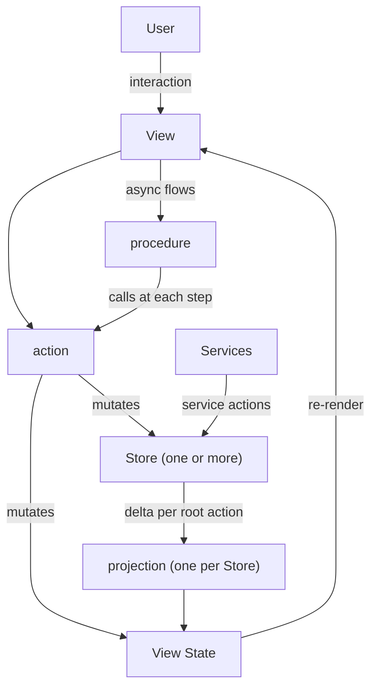

# SivKit
The library is experimental and subject to API changes.

SivKit provides shared infrastructure for building apps in Python and TypeScript. It's not a GUI framework — it provides entities, stores, actions, projections, procedures and channels, while leaving view/state binding to the platform (Qt, React+MobX, etc.). It also documents a set of platform-independent principles for structuring GUI apps.

Used in [Pamet](https://github.com/v-ko/pamet) (React+MobX web app, Qt WebEngine desktop), Curator (React+MobX web app, Python server) and vii-assistant (Python+Qt). The latter two are not yet published.

## Installation
- Python: `pip install sivkit`
- TypeScript: the `sivkit/` package is used as a local dependency (see `typescript/`)

## Architecture

The architecture is inspired by the [Flux](https://facebookarchive.github.io/flux/) pattern and the standard MVC.

The UI operates with domain stores holding the app's entities. Persistence and sync are handled additionally. Changes in the stores are projected onto the view model — the UI components' **view states**. Views are implemented with a reactive framework (React+MobX or Qt), so any change to the view state triggers a re-render. Views can call **actions** (decorated synchronous functions). In actions, the view state can be altered, as well as the domain stores (only there!). The changes are visualized to the user. And the cycle is completed.

Async flows (network, workers, etc.) are written as **procedures** — async functions that call actions at each step. **Services** also feed their changes into the stores through actions.

After the outermost (root) action completes, the store changes it produced are handed to each store's **projection**, and **root action hooks** fire — used for undo recording, auto-save, logging, etc.



### Concepts

- **`Entity`** — base model class with serialization and a type registry (`@entityType` / `@entity_type`). Store operations produce `Change` objects (CREATE/UPDATE/DELETE), aggregated into `Delta`s.
- **`Store` / `InMemoryStore`** — entity CRUD. Every mutation calls the store's on-changes callbacks (`addOnChangesCallback`) with the resulting `Delta`. A store registered with a projection can only be changed inside actions.
- **View state** — the view model: observable state the views render from (MobX observables in TS, `QObject` + `Signal` + `Property` in Qt).
- **`@action`** — synchronous function/method decorator. Wraps calls in MobX `runInAction` (TS) or a call context (Python). Tracks a call stack so that only **root** action completion triggers the projections and hooks.
- **Projection** — one per store (`registerProjection(store, projector)`). Gets the store's merged delta and the store after each root action and maps them onto view states. View states written only by projections subclass `ProjectedViewState`.
- **Procedure** — an async function for multi-step flows, which calls actions at each step. In Python `@procedure` schedules it as an asyncio `Task` on the Qt main thread.
- **Services and the facade** — services encapsulate integrations (storage, sync, networking, OS). They change stores through actions marked `issuer='service'`. The facade holds and wires them, and is the one place where cross-hierarchy access is defined.
- **`@command`** — a user-invocable entry point (shortcuts, menus, command palette), with enablement based on context derived from the view state.
- **`Channel`** — named pub/sub bus for decoupled communication between services.
- **`Repository` / sync services** — version-controlled persistence (commits of deltas) and store synchronization over WebSocket or REST.

## Full example (TypeScript / React+MobX)

Below is a condensed but complete picture: entity, view states, store+projection wiring, actions, a React component, and hook registration.

```typescript
// --- 1. Entity definition (fusion) ---
import { entityType, Entity, EntityData, getEntityId } from "sivkit/model/Entity";

interface TodoData extends EntityData {
    text: string;
    done: boolean;
}

@entityType('Todo')
class Todo extends Entity<TodoData> {
    get text() { return this._data.text; }
    get done() { return this._data.done; }
}


// --- 2. View states (MobX) ---
import { observable, makeObservable, ObservableMap } from "mobx";
import { ProjectedViewState } from "sivkit/registries/Projection";

class TodoViewState extends ProjectedViewState {  // projection-managed
    _data: TodoData;
    constructor(todo: Todo) {
        super();  // throws outside a projection
        this._data = todo.data();
        makeObservable(this, { _data: observable });
    }
    get text() { return this._data.text; }
    get done() { return this._data.done; }
    update(todo: Todo) {
        this._data = todo.data();
    }
}

class AppViewState {
    todosById: ObservableMap<string, TodoViewState> = observable.map();  // projection-written
    selectedId: string | null = null;                                   // action-written
    constructor() {
        makeObservable(this, { todosById: observable, selectedId: observable });
    }
}


// --- 3. Store + projection wiring ---
import { InMemoryStore } from "sivkit/storage/domain-store/InMemoryStore";
import { Delta } from "sivkit/model/Delta";
import { registerProjection } from "sivkit/registries/Projection";

const store = new InMemoryStore();
const appState = new AppViewState();

// The projector: maps the store's delta (per root action) to view state updates
registerProjection(store, (delta: Delta) => {
    for (const change of delta.changes()) {
        if (change.isDelete()) {
            appState.todosById.delete(change.entityId);
            continue;
        }
        const todo = store.findOne({ id: change.entityId }) as Todo;
        const todoVS = appState.todosById.get(todo.id);
        if (todoVS) todoVS.update(todo);
        else appState.todosById.set(todo.id, new TodoViewState(todo));
    }
});


// --- 4. Actions ---
import { action, registerRootActionCompletedHook } from "sivkit/registries/Action";

class TodoActions {
    @action
    addTodo(text: string) {
        const todo = new Todo({ id: getEntityId(), parent_id: '', text, done: false });
        store.insertOne(todo);  // → projected into view state after the root action
    }

    @action
    toggleDone(todoId: string) {
        const todo = store.findOne({ id: todoId }) as Todo;
        const updated = todo.copy();
        updated.replace({ done: !todo.done });
        store.updateOne(updated);  // → projected into view state after the root action
    }

    @action
    select(state: AppViewState, todoId: string) {
        state.selectedId = todoId;  // primary view state, changed directly
    }
}

const todoActions = new TodoActions();


// --- 5. Root action hooks (undo, auto-save, etc.) ---
registerRootActionCompletedHook((rootAction) => {
    // e.g. record undo, save to backend, log
    console.log('Action completed:', rootAction.name);
});


// --- 6. React component ---
import { observer } from "mobx-react-lite";

const TodoList = observer(({ state }: { state: AppViewState }) => (
    <ul>
        {[...state.todosById.values()].map(todoVS => (
            <li key={todoVS._data.id}
                style={{ textDecoration: todoVS.done ? 'line-through' : 'none',
                         fontWeight: state.selectedId === todoVS._data.id ? 'bold' : 'normal' }}
                onClick={() => todoActions.select(state, todoVS._data.id)}
                onDoubleClick={() => todoActions.toggleDone(todoVS._data.id)}>
                {todoVS.text}
            </li>
        ))}
        <button onClick={() => todoActions.addTodo('New item')}>Add</button>
    </ul>
));
```

The same pattern applies in Python/Qt — entities, stores and projections are the same, view states use `QObject` + `Signal` + `Property`, and actions are `@action`-decorated functions.

```python
# --- View state ---
from sivkit.platform.qt_widgets import Property
from PySide6.QtCore import QObject, Signal

class CounterViewState(QObject):
    count_changed = Signal(int)

    def __init__(self):
        super().__init__()
        self._count = 0

    @Property(int, notify=count_changed)
    def count(self) -> int:
        return self._count

    @count.setter
    def count(self, value: int):
        if self._count == value:
            return
        self._count = value
        self.count_changed.emit(value)

# --- Action ---
from sivkit.libs.action import action

@action("counter.increment")
def increment(state: CounterViewState, amount: int = 1):
    state.count = state.count + amount
```

For QML, expose the view state and a thin `@Slot` ViewModel via `setContextProperty`. For QWidgets, connect to signals directly.

### QWidgets example

The widget connects directly to the view state's signals:

```python
from PySide6.QtWidgets import QLabel, QPushButton, QVBoxLayout, QWidget


class CounterWidget(QWidget):
    def __init__(self, state: CounterViewState):
        super().__init__()
        self._state = state

        self._label = QLabel(str(state.count))
        btn = QPushButton("+1")
        btn.clicked.connect(lambda: increment(self._state))

        layout = QVBoxLayout(self)
        layout.addWidget(self._label)
        layout.addWidget(btn)

        # View reacts to state changes
        state.count_changed.connect(self._on_count_changed)

    def _on_count_changed(self, value: int):
        self._label.setText(str(value))
```

### QML example

A ViewModel bridges the view state to QML-compatible `Property` declarations:

```python
# counter_view_model.py
from PySide6.QtCore import Property, QObject, Signal, Slot


class CounterViewModel(QObject):
    count_changed = Signal()

    def __init__(self, state: CounterViewState, parent=None):
        super().__init__(parent)
        self._state = state
        state.count_changed.connect(self.count_changed)

    @Property(int, notify=count_changed)
    def count(self) -> int:
        return self._state.count

    @Slot()
    def increment(self):
        increment(self._state)
```

Expose it to QML:

```python
vm = CounterViewModel(state)
engine.rootContext().setContextProperty("counterVM", vm)
```

The QML view binds to the ViewModel:

```qml
import QtQuick
import QtQuick.Controls

Column {
    Label { text: counterVM.count }
    Button {
        text: "+1"
        onClicked: counterVM.increment()
    }
}
```

## Testing
- Python: `cd python && pytest`
- TypeScript: `cd typescript && npm test` (Jest)
- Cross-language hash parity: `bash tests/hash-parity/run.sh`, which checks that the Python and TS hash trees produce the same root hashes
- Serialized entity hash parity and replay: `PYTHON=../dev_venv/bin/python bash tests/hash-parity/run.sh tests/hash-parity/fixtures/entity-data-semantics.json`, which checks exact serialized entity data, checkpoint hashes, and composed/sequential undo.

Parity fixture files are JSON arrays of test cases. Generated fuzz and database exports contain one named case; regression fixtures contain several. Both language runners execute every case.

Since every state change passes through actions, a session can in principle be recorded (root actions plus the view state they touched) and replayed as a test. This is planned, see [docs/ui-testing-via-action-replay.md](docs/ui-testing-via-action-replay.md).


## Details and guidelines

### Actions and store operations
Actions are synchronous functions, where everything is on the main thread. ***Changes in the domain stores and (primary) view states should happen in actions when we're implementing a frontend***. This allows for full state tracking and recordability. It also allows features like undo to be tied to the action completion hook interface. Actions can be nested (call one action within another) with any state mutation calls being applied synchronously.

We can use stores in the backend as well. There we don't need to wrap store operation calls in actions, but still a store must only be called from its owning thread (in Python `InMemoryStore` binds to the first thread that uses it, `bind_to_current_thread()` rebinds it, and other threads get a `StoreThreadViolation`). The main reason for that is that we allow for on_changes hook subscriptions of arbitrary code, and we want to avoid the risks of deadlocks and other complexity related to those. If you need to make store calls from threads/async - you should implement a service living in the owning thread that wraps the threaded/async functionality and executes the store calls (e.g. marshal onto it with `loop.call_soon_threadsafe`). For persistence, use the version control classes (`Repository` with a VCS adapter), described in [Storage and version control](#storage-and-version-control) below.

### Projections
When domain objects change (e.g. the Note object's text is changed) - we want to have a *projection* to translate that change from the domain model to the view model. So e.g. if a page is open and a note is deleted - the projector function removes the view state for that note and the view layer reacts accordingly to disappear the note.

Each store has one projection, registered with `registerProjection(store, projector)` (py `register_projection`). The projector is called every time that a root action completes, with the store's changes from that action merged into one delta (possibly empty) and the store, and runs inside `runInProjection`. That also allows us to assert its correct usage. Other inputs, like the view state to write to, are bound when registering, e.g. `registerProjection(store, (delta, store) => project(appState, delta, store))`.

The view states that are managed by projection are subclasses of ProjectedViewState, and can only be created inside a projection. They are generally not handled in the action layer. So the view state objects are mutated EITHER by an @action, OR by the projection function (by domain store changes).

 * Reactions - if we find ourselves in need of doing view state updates based on other viewstate changes - we probably need a projector from the source domain state. Reactions are an antipattern

### Procedures
Procedures are async functions that define flows of several steps, which need view state or store updates in between. So basically when you need an async action - you write a procedure. Example: loading data from a slow connection or doing a cpu task in a worker - you want to mark in the UI it's started (Loader dialog, freezing of elements, etc), do it, report progress, and close the dialog. All UI changes are made by calling action functions (synchronous) in between doing the async tasks.

In TS procedures are plain async functions. In Python they're decorated with `@procedure` and run as asyncio Tasks on the Qt main thread.

#### Setup (Python)

The Qt-asyncio integration must be installed before any procedure can run. This happens automatically when using `QtMainLoop`:

```python
from sivkit import set_main_loop
from sivkit.platform.qt_widgets.qt_main_loop import QtMainLoop

app = QApplication(sys.argv)
set_main_loop(QtMainLoop(app))  # installs the async event loop
app.exec()
```

Under the hood, [qasync](https://github.com/CabbageDevelopment/qasync) integrates asyncio into Qt's event loop (`QTimer` for scheduled callbacks, `QSocketNotifier` for I/O on Unix, IOCP on Windows). Everything runs on the main thread — no cross-thread state access issues, same model as JavaScript.

#### Usage (Python)

```python
from sivkit import procedure
from sivkit.libs.action import action

@action('update_shapes')
def update_shapes(overlay, shapes):
    overlay.shapes = shapes

@procedure
async def run_experiment(facade):
    screenshot = take_screenshot()
    shapes = await detect_shapes(screenshot)  # suspends, Qt keeps running
    update_shapes(facade.overlay, shapes)     # sync action, immediate
```

Calling a `@procedure` function schedules it as a Task and returns the Task immediately. It can be called from sync code (fire-and-forget) or awaited from other async code.

#### Task handling

Procedures return a `Task` subclass with fluent Promise-like methods for handling results and errors:

```python
from sivkit.libs.procedure import procedure
from sivkit.libs.action import action

@action('show_data')
def show_data(view_state, data):
    view_state.data = data

@action('show_spinner')
def show_spinner(view_state, visible: bool):
    view_state.spinner_visible = visible

@procedure
async def fetch_data(view_state, url: str) -> None:
    show_spinner(view_state, True)
    try:
        async with httpx.AsyncClient() as client:
            resp = await client.get(url)
            resp.raise_for_status()
            data = resp.json()
    except Exception:
        raise
    finally:
        show_spinner(view_state, False)
    show_data(view_state, data)

# In a ViewModel slot — fire-and-forget with error logging:
def on_button_clicked(self):
    fetch_data(self._state, "http://localhost:8000/api") \
        .catch(lambda exc: log.error("Fetch failed: %s", exc))
```

- `.then(on_result)` — called with the return value on success
- `.catch(on_exception)` — called with the exception on failure (not on cancel)
- `.on_cancel(callback)` — called when the task is cancelled
- `.finally_(callback)` — called regardless of outcome

All methods return `self` for chaining. Actions are called inside the procedure around the async work — the call site only needs `.catch()` for logging unexpected failures.

#### Guidelines

- **Single thread**: Procedures run on the Qt main thread. No locks needed between procedures and actions.
- **Actions inside procedures**: Call actions normally — they execute synchronously at the `await` yield points.
- **Fire-and-forget**: Call from a Qt slot or callback — the Task runs in the background. Use `.catch()` to handle errors.
- **Awaitable**: From other async code, `await my_procedure()` to get the result.
- **Futures for external events**: Create an `asyncio.Future`, store it, `await` it. Resolve it from a callback (e.g. store change handler). This bridges event-driven callbacks into linear async flow.

```python
@procedure
async def wait_for_inference(self):
    self._future = asyncio.get_running_loop().create_future()
    result = await asyncio.wait_for(self._future, timeout=120)
    # ... use result

def on_store_change(self, change):
    # called by a store callback on the same thread
    if self._future and not self._future.done():
        self._future.set_result(change.data)
```

### Commands
Commands are one layer above the views. Typically activated by shortcuts, menu entries, or the command palette. Commands are enabled/disabled possibly based on a context dictionary, which is derived from the viewState (not imperatively altered!).

In TS `@command(title, enablement)` takes an enablement condition that the app evaluates against the context (e.g. Pamet's keybinding service and command palette). In Python `@command(title, name='')` registers the function (listed via `get_commands()`), and it is called with the context as keyword arguments. There's no enablement condition in Python yet.

### Storage and version control
Every change to a domain store is already a delta, so keeping the history is just a matter of keeping the deltas. SivKit's version control does exactly that: a commit is a delta, a branch is a chain of them, and replaying a branch gives you the state. Pamet uses it both for syncing (between tabs, and with the server) and for tracking the full change history of a project. Saving, syncing and rolling back all come down to the same move: compare commit graphs, fetch what's missing, apply it.

See the shared [delta protocol](docs/delta-protocol.md) for change semantics and replay rules.

It is modeled on git (commits, branches, a head), but commits are not content-addressed: ids are random, and the hash chain git relies on is absent. That keeps the per-action histories cheap to squash without rewriting everything after them. A snapshot hash of the resulting state is still recorded with each commit, as an integrity check.

- **`Repository`** — the commit graph plus a **head store** (an `InMemoryStore` with the committed state). `commit(delta, message)` applies and persists a delta; `reset` undoes commits. In TS it's async and also supports `pull`, `createBranch` and conflict-skipping commits.
- **VCS adapters** — where commits are persisted: IndexedDB or a REST backend in the browser, SQLite in Python, in-memory for tests.
- **`StorageService` / `ProjectStorageManager`** (TS) — the repository lives in a shared worker, one per browser, which serializes commits from all tabs and broadcasts the updates. The UI commits optimistically through a service and reconciles when the update comes back, so the user never waits for a save.

For adapter choices, worker setup and addon lifecycle, see [TypeScript storage setup](docs/storage-setup.md).

#### Sync services
Sync services keep two stores in step by exchanging deltas. Remote changes are applied in an `issuer='service'` action whenever the store requires actions.

- **`WebSocketSyncService`** (TS, Python) — bidirectional. The **authority** owns the canonical state and sends it in full on connect; the **receiver** loads it, and both sides then push acknowledged deltas. The authority (Python for now) resolves conflicts according to its sync mode: `OT` (the default: the authority sequences the deltas, transforms stale ones server-wins and sends a correction back), `REJECT` (stale deltas are refused, so the receiver re-reads and retries) or `LOCKING` (only the lock holder writes; not implemented yet). In Python, `StarletteSyncEndpoint` serves it on a WebSocket route and `WebSocketsClientSync` connects to one.
- **`RestSyncService`** (TS) ↔ **`StoreSyncService`** (Python) — the full state over GET, local deltas over POST, and remote deltas streamed via SSE. A client that has fallen too far behind gets a full reload.

#### Planned: peer-to-peer sync
Direct device-to-device sync over WebRTC, with each device as a branch in the repository. The branches get exchanged in any order and merged automatically, by device priority: on a conflict the lower-priority device adapts, and the higher-priority one keeps its head. The pieces for this (branches, commit graph diffing, commits that skip conflicting changes) are already in place.


### Main, Facade and progressive complexity of the app architecture
The main() entry point can be a whole app if we're building something simple. Later we add modules when the code size baloons. Typically we're building services with a programatic interface (exposed OS-local or to the web) and/or OS-interactions (other local services or file-system) and/or UI-interactions.

The main() can hold everything, but for readability and for the sake of defering the import of heavy dependencies we split the code into modules (the source-tree).

Our program will probably need different configurations if ran on different devices or conditions. E.g. preferences passed by OS environment variables, per-run command line arguments, or auto-detected hardware and software conditions (gpu present, system color theme, etc.). The main() can still be the place to add this logic, but that can also baloon in size. Something else that can baloon in size is the count of our objects dealing with all kinds of stuff - integration services, storage, UI-related classes. And ALL OF THEM want to talk to eachother. But if we start just wiring them together - that allows bugs of unimaginable complexity, along with making the code components untestable in isolation.

So we setup some conventions to deal with that.
- UI interactions are processed in layers as explained above (Views/ViewStates/Actions/object Stores).
- Interactions with storage and networking (game progress save, document output, web collaboration) usually benifit Adapter classes, synchronization service classes, in-memory object Stores, etc. Persisting and sharing data can be *hard*.
- CPU heavy work or non-trivial data transformation logic needs its own patterns. Computing the next frame of the game or processing an inflow of user requests for your social network app can be an infinitely complex task, which should be split into a plethora of class types with specific responcibilities and lifecycle. I.e. there's no universal answer but good examples are:
  - Adapter - implements a stable interface to some other service (over network, other transport) or a storage medium (db, file-system). Does not have state.
  - Service - class instances that encapsulate some functionality and have state.
  - Manager - a service which composes several adapters or other services and coordinates their operation.

Access to all of those components, as mentioned above, should be controlled. E.g. a user presses ctrl+z and a view wants to call the undo service and restore the last revision to the document store. Or the rendering preparation service needs to call the physics engine to get some parameters of the new car-wreck that the user is about to cause in the game. Some of this spaghetti is solved by doing heirarhy and scoping. The OOP principles apply here. But in reality even in a good hierarchy - the janitor may can say hi to the president. If the latter is not occupied.

**The facade is the place where we define which cross-hierarchy calls are allowed and when.** It's the place where we explicitly track coupling between components that live in different scopes or levels.

#### Service dependencies, wiring and lifecycle
- Dependencies - services may use other objects for their operation (other services, functions, vars). They should receive them on construction and have them as narrow as possible. All services having access to the whole facade is risky.
- Wiring is e.g. the subscriptions of a service, connections to collaborators. Mostly setting up callbacks and messaging channels.
- Lifecycle is the enabling/disenabling (start/stop) of a service without scrapping it in the mean time.

Wiring can be done by the service itself on construction. Or if there are sibling services - it should be done by the parent. That's either the facade or if that gets overcrowded - we can group facade logic and members into domain attributes like facade.{storage,theme,router}. The domain could be useful way late when there's really a lot of functionality to organize. **If the facade is like a scope to composit services into - the domain is a sub-facade with a topic**. So wiring should happen in the service constructor if it only uses service dependencies and will not be altered. Else it should be done by some parent or grand-parent (closest possible to narrow scope access),

In short:
- Main deals with app configuration variability. Can hold everything really if the app is small enough.
- The facade is the scope for accessing functionality within the app without tightly coupling everything. It wires its children if needed and can hold references to helpers. Avoid putting logic here.
- It can be composed of domains if it gets really big.
- Views have access to the facade (respectively services), and actions. They should not do heavy calls.
- Actions are synchronous functions and only get passed ViewStates, Stores and plain data arguments.
- Procedures are async flows (any orchestration involving async operations) that call actions at each step. Views and services call them.
- Services should receive their dependencies on construction and be wired on construction or by their parent (scope) where needed. They can invoke actions and procedures, but should mark them with issuer=service.

### Allowed vertical dependencies
Inside of a vertical generally all access is permitted, given that we try to keep it sane - hierarchical organization is important to avoid unnecessary spaghettification. So an action can call any other action. A view can access any other view. Same for ViewStates.

Views receive user input. They should freely access actions. Also via the facade they can access services. Since ViewStates are the source of truth for the display - views should have access to the whole view state vertical via the facade. But altering the view-states directly is prohibited.

Actions should not touch views. They are the only place view-states are altered (apart from projection-managed ones, which the projections write). Optimally actions would receive the view states that they work with via argument (though in practice that's not enforced yet). Actions have domain-store access, and should also be the only place domain-store changes are made. The reason for that is that we wire domain-store changes to projector functions, which make view-state changes to reflect domain changes in the view layer.

### Model library
Entity constraints: serialization is done 3 levels deep. So note.content.image.width is good. But any deeper than that is out of scope. Diffing is done 1 level deep. So when you change the image.width - the setter method should swap the content object.

## Future
- Enforce the design patterns with custom ESLint rules for TS and an AST-based checker for Python.
- Async `Repository` in Python, matching the TS interface (pull, branches, conflict-skipping commits).
- `LOCKING` sync mode.
- Peer-to-peer sync (see [Planned: peer-to-peer sync](#planned-peer-to-peer-sync)).
- Compare with Yjs.
