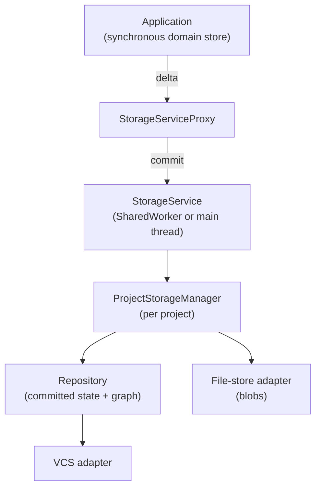
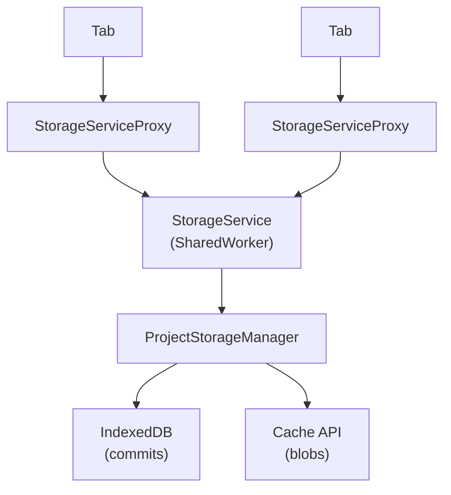
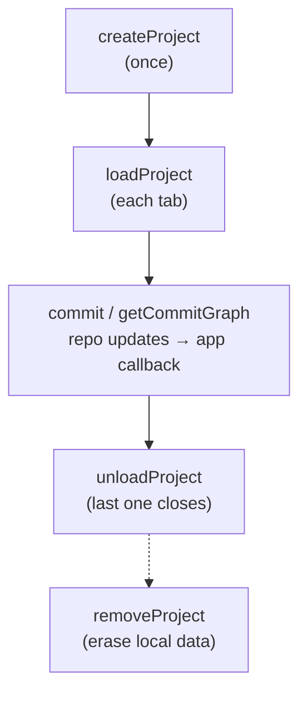
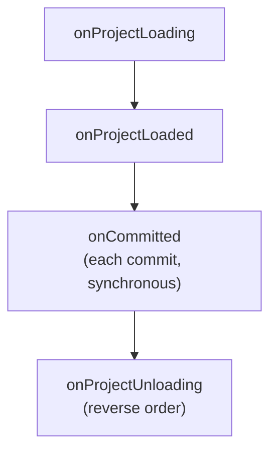

# TypeScript storage setup

`Repository` keeps committed entity state and a commit graph. VCS adapters persist commits; file-store adapters keep blobs outside that graph. `StorageService` coordinates one loaded `ProjectStorageManager` per project, and `StorageServiceProxy` provides the tab-side interface.

Repo updates are broadcast to connected proxies. The application supplies the callback that reconciles its domain store with the committed state; the proxy does not update the UI store itself.

## Reference setup: browser-local

All data stays on the device. Tabs share one service running in a SharedWorker; commits go to IndexedDB and blobs to the Cache API.

The worker and every tab register the same entity classes. A project is described by a `ProjectStorageConfig`: project ID, device branch name, and which VCS and file-store adapters to construct.

Creating a project does not leave it loaded. Each load holds a reference, and the last unload closes the shared session. Loads during removal and commits to a closing project reject with `ProjectStorageLifecycleError`.

## Other setups

- **No worker** — `setupInMainThread()` runs the service inside the tab, so each tab has its own. The application decides whether to fall back to this when worker startup fails.
- **Backend project folder** — commits stay in IndexedDB; files and domain entities go through REST adapters to a backend that owns the folder.
- **Backend-hosted history** — commits and files both go through REST.
- **In-memory** — for ephemeral work and tests; nothing outlives the adapter.

REST adapters need a backend implementing their endpoints; they are not generic HTTP stores. Removing a REST-backed project only drops local tracking. The optional domain-store adapter supplies entities on load and receives committed deltas; it is separate from the VCS adapter.

## Addons

Addons attach per-project behavior to the service, e.g. bridging to an external source. They are registered with the service as descriptors and receive lifecycle hooks:

Register addons that provide resources before those that depend on them. A descriptor may also erase addon-owned local data when a project is removed.

See the [delta protocol](delta-protocol.md) for change and replay semantics, and the [storage management source](../typescript/src/storage/management) for API details.
