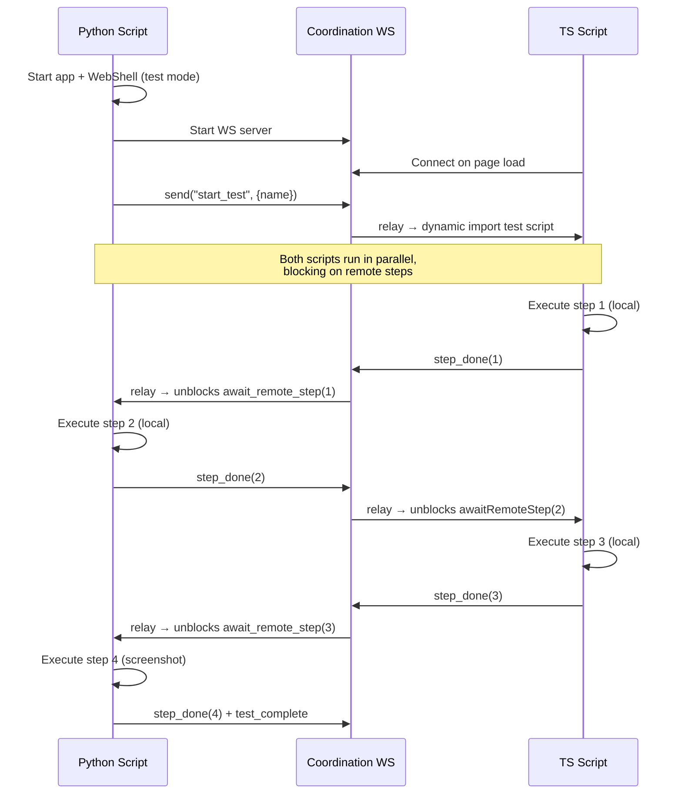

# Action System & Cross-Boundary Testing — Plan

## Completed (Phases 1–4)

- Action lib rewritten to TS parity: single file `sivkit/libs/action.py`
- `ActionState`, `ActionRunStates`, synchronous hook lists, call stack — all match TS `Action.ts`
- Dead code removed: `ChangeAggregator`, `action_call.py`, thread-queueing, view-lock guards, Channel dispatch
- Pamet GUI action decorated (`close_tab`)
- 15 unit tests passing

---

## Phase 5 — Deterministic IDs

Both sides already have the infrastructure (`_reproducible_ids` + `random.seed(0)` in Python, `_deterministicIds` flag in TS `util/base.ts`). Need to wire it up so both sides produce the same sequence.

- [ ] Python: `set_reproducible_ids(True)` at test-mode startup (already exists, uses `random.seed(0)`)
- [ ] TS: extend `createId()` to use a seeded PRNG when `_deterministicIds` is true (currently falls through to `Math.random()` which isn't seeded)
- [ ] Both sides must use the same seed and alphabet — verify they produce the same ID sequence
- [ ] ActionCamera records the deterministic IDs assigned to view states during the session

## Phase 6 — ActionCamera (Python)

**Scope:** `sivkit/visual_inspection/action_camera.py`

- [ ] Remove stale imports (`pamet.desktop_app`, `ViewState`, `on_actions_logged`, `ActionCall`)
- [ ] Wire to `register_root_action_completed_hook` — record root user actions
- [ ] On each root action: snapshot all view state attributes that were touched (before/after dicts via `dump_to_dict()`)
- [ ] Output: one `.py` test script to `tests/tmp/`

## Phase 7 — ActionCamera (TypeScript)

**Scope:** new file in `pamet/web-app/src/`

- [ ] Build TS ActionCamera — register via `registerRootActionCompletedHook`
- [ ] On each root action: snapshot view state attributes touched
- [ ] Output: one `.ts` test script to `tests/tmp/`

## Phase 8 — Test Script Format

Both scripts contain **all steps from both sides**. Local steps are executed; remote steps are awaited (expected by step ID). This keeps both scripts in sync without the coordination service needing to know the step order.

### Example — TS script (`test_create_note.ts`)

```typescript
import { Coordinator } from '@/testing/Coordinator';
import { pageActions } from '@/actions/page';
import { noteActions } from '@/actions/note';
import { pamet } from '@/core/facade';
import { PageViewState } from '@/components/page/PageViewState';
import { Note } from '@/model/Note';

// All view states use deterministic IDs from seeded PRNG
export async function runTest(c: Coordinator) {
    // Step 1 (local) — navigate to page
    const pageVS = pamet.appViewState.currentPageViewState!;
    appActions.navigateToPage(pamet.appViewState, 'test-page-id');
    c.assertState('pageVS.id', pageVS.id, 'ab12cd34');
    await c.stepDone(1);

    // Step 2 (remote/python) — python creates a note via REST
    // We just wait for it and verify the expected state after
    await c.awaitRemoteStep(2);
    const note = pamet.note('ef56gh78')!;
    c.assert(note !== null, 'note should exist after python step 2');
    c.assertState('note.content.text', note.content.text, 'Hello from Python');

    // Step 3 (local) — start editing the note
    const noteVS = pageVS.noteViewStatesById.get(note.id)!;
    noteActions.startNoteEdit(pageVS, noteVS);
    c.assertState('pageVS.mode', pageVS.mode, PageMode.None);
    await c.stepDone(3);

    // Step 4 (remote/python) — python takes a screenshot
    await c.awaitRemoteStep(4);
}
```

### Example — Python script (`test_create_note.py`)

```python
from pamet.testing.coordinator import Coordinator
from pamet.model.text_note import TextNote
import pamet

def run_test(c: Coordinator):
    # Step 1 (remote/ts) — TS navigates to page
    c.await_remote_step(1)
    page = pamet.page('test-page-id')
    assert page is not None

    # Step 2 (local) — create a note via the storage service
    note = TextNote(id='ef56gh78', parent_id='test-page-id')
    note.content = {'text': 'Hello from Python'}
    pamet.insert_note(note)
    c.step_done(2)

    # Step 3 (remote/ts) — TS starts editing
    c.await_remote_step(3)

    # Step 4 (local) — take screenshot
    c.screenshot('after_note_edit')
    c.step_done(4)
```

### Key points

- **All steps numbered globally** — both scripts see the same sequence
- **Local steps**: execute action, optionally assert state, then `step_done(N)`
- **Remote steps**: `await_remote_step(N)` / `await c.awaitRemoteStep(N)` — blocks until the other side signals completion of step N
- **State assertions**: after each step, compare view state attributes against expected values (recorded by ActionCamera using deterministic IDs)
- **Entity args**: TS uses inline constructors or `Entity.loadFromDict({...})`; Python uses model constructors directly

## Phase 9 — Coordination WebSocket Service

**Scope:** Python server + TS client

### Protocol

Messages carry a step number for ordering:
- `{ type: 'step_done', step: N }` — sender completed step N
- `{ type: 'await_step', step: N }` — receiver blocks until step N is done
- `{ type: 'test_complete' }` — all steps done



### Implementation

**Python `Coordinator`** — pumps Qt event loop while waiting:

```python
class Coordinator:
    def __init__(self, ws_server, app):
        self._ws = ws_server
        self._app = app
        self._completed_steps: set[int] = set()

    def step_done(self, step: int):
        self._completed_steps.add(step)
        self._ws.send({'type': 'step_done', 'step': step})

    def await_remote_step(self, step: int, timeout=10):
        deadline = time.time() + timeout
        while step not in self._completed_steps:
            self._app.processEvents()
            if time.time() > deadline:
                raise TimeoutError(f"Remote step {step} timed out")
            time.sleep(0.01)

    def screenshot(self, name: str):
        pixmap = self._web_view.grab()
        pixmap.save(f'tests/tmp/{name}.png')
```

**TS `Coordinator`** — async/await:

```typescript
class Coordinator {
    private ws: WebSocket;
    private completedSteps = new Set<number>();
    private stepResolvers = new Map<number, () => void>();

    constructor(ws: WebSocket) {
        this.ws = ws;
        ws.addEventListener('message', (msg) => {
            const data = JSON.parse(msg.data);
            if (data.type === 'step_done') {
                this.completedSteps.add(data.step);
                this.stepResolvers.get(data.step)?.();
            }
        });
    }

    stepDone(step: number) {
        this.completedSteps.add(step);
        this.ws.send(JSON.stringify({ type: 'step_done', step }));
    }

    async awaitRemoteStep(step: number): Promise<void> {
        if (this.completedSteps.has(step)) return;
        return new Promise(resolve => {
            this.stepResolvers.set(step, resolve);
        });
    }

    assertState(label: string, actual: any, expected: any) {
        if (actual !== expected) {
            throw new Error(`${label}: expected ${expected}, got ${actual}`);
        }
    }
}
```

## Phase 10 — ReplayTester + Test Script Loading

### How TS test scripts are loaded

The app already has a `main.tsx` that switches between `main-desktop.tsx` and `main-web.tsx` via `import.meta.env.BUILD_MODE`. The cleanest approach for test mode:

**Option A — Add a `test` build mode** (recommended):
- Add `case 'test': void import('./main-test'); break;` to `main.tsx`
- `main-test.tsx` imports `main-desktop.tsx` (full app bootstrap), then after init connects the Coordinator WS and dynamically imports the test script
- Vite's `define` replaces `BUILD_MODE` at build time — in production it's `'desktop'` or `'web'`, so the `'test'` branch is dead-code-eliminated
- No guards needed on the test code — the import path simply doesn't exist in prod bundles

```typescript
// main-test.tsx
import './main-desktop';  // boot the full app
import { Coordinator } from '@/testing/Coordinator';

// Connect to coordination WS (port passed via URL param or env)
const wsUrl = new URLSearchParams(location.search).get('coordWs') ?? 'ws://localhost:9876';
const ws = new WebSocket(wsUrl);
const testName = new URLSearchParams(location.search).get('test')!;

ws.onopen = async () => {
    const coordinator = new Coordinator(ws);
    const testModule = await import(`./tests/${testName}.ts`);
    await testModule.runTest(coordinator);
    coordinator.ws.send(JSON.stringify({ type: 'test_complete' }));
};
```

**Option B — Separate `index-test.html`**: a completely separate HTML entry point that loads `main-test.tsx`. More explicit isolation but requires a second Vite config or multi-page setup. Only worth it if there's concern about test code leaking.

**Recommendation:** Option A. The `BUILD_MODE` switch already handles this pattern. One extra case, zero build config changes, Vite eliminates the dead branch in prod.

### Where test scripts live

```
pamet/web-app/src/testing/          ← TS test infrastructure (Coordinator, etc.)
pamet/web-app/src/testing/scripts/  ← generated .ts test scripts (gitignored except committed ones)
pamet/server/pamet/testing/         ← Python test infrastructure
pamet/tests/scripts/                ← generated .py test scripts
pamet/tests/fixtures/screenshots/   ← reference images
```

TS test scripts go under `web-app/src/testing/scripts/` so they:
- Get full `@/` alias resolution and type-checking from `tsconfig.json`
- Are importable via dynamic `import()` from `main-test.tsx`
- Are **never** reachable from `main-desktop.tsx` or `main-web.tsx` → never bundled in prod

### Python ReplayTester

- [ ] CLI entry point: `python -m pamet.testing.replay --test test_create_note`
- [ ] Sets `BUILD_MODE=test` (or passes `?coordWs=...&test=test_create_note` as URL params to WebShell)
- [ ] Starts app + WebShell pointed at the test URL
- [ ] Starts coordination WS server
- [ ] Loads and executes `tests/scripts/test_create_note.py`
- [ ] On completion: capture screenshots, report pass/fail

## Phase 11 — Screenshot Comparison

- [ ] Python side: `QWebEngineView.grab()` → save PNG to `tests/tmp/`
- [ ] Reference images in `tests/fixtures/screenshots/`
- [ ] Perceptual diff (SSIM) — not pixel-exact
- [ ] Report: pass/fail with diff image output

---

## File Layout

```
pamet/
├── web-app/src/
│   ├── main.tsx                         ← adds 'test' case
│   ├── main-test.tsx                    ← test mode bootstrap
│   └── testing/
│       ├── Coordinator.ts               ← WS client + step sync + assertions
│       ├── ActionCamera.ts              ← records actions → .ts scripts
│       └── scripts/                     ← generated TS test scripts
│           └── test_create_note.ts
├── server/pamet/
│   └── testing/
│       ├── action_camera.py             ← records actions → .py scripts
│       ├── coordinator.py               ← WS server + step sync
│       ├── replay_tester.py             ← CLI runner
│       └── screenshot_compare.py
└── tests/
    ├── scripts/                         ← generated Python test scripts
    │   └── test_create_note.py
    ├── tmp/                             ← runtime output (gitignored)
    └── fixtures/
        └── screenshots/                 ← reference images
```

## Risks

| Risk | Severity | Mitigation |
|------|----------|------------|
| Qt event loop side effects during wait | Medium | Disable timers/background services in test mode |
| Deterministic ID sequence divergence | Medium | Verify both sides use same seed + alphabet in CI |
| Screenshot flakiness | High | SSIM diff, generous threshold, fixed resolution |
| WS message races | Low | Step numbers make ordering explicit |
| Test scripts accidentally imported in prod | None | `BUILD_MODE` switch dead-code-eliminates the `'test'` branch |
| Qt event loop side effects during wait | Medium | Disable timers/background services in test mode |
| Entity schema mismatch Python↔TS | Low | Shared model, CI catches drift |
| Screenshot flakiness | High | SSIM diff, generous threshold, fixed resolution |
| WS coordination races | Medium | Sequence numbers + timeouts |
| Action name→TS import mapping goes stale | Medium | Auto-generate from TS `@action` decorators |
